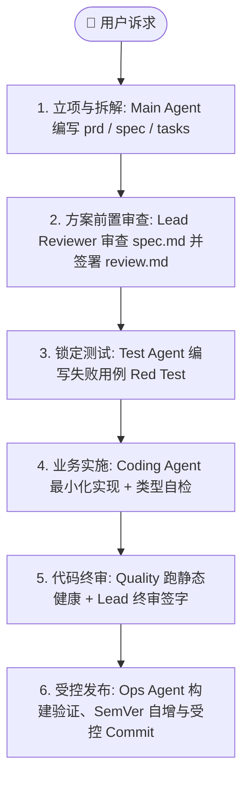

# Herdr Teamwork ⚡

> **Multi-Agent Spec Implementation Framework Orchestrated via Herdr**
> 
> 基于 **Herdr** 终端工作区管理工具构建的多 Agent 物理隔离与协同流水线工程规范。遵循 **OpenSpec 演进标准** 与 **事件驱动免轮询机制 (`herdr agent wait`)**，实现业务规格持久化、职责绝对正交与分形审查网络。

[](https://skills.sh)
[](LICENSE)

---

## 🚀 快速安装 (Installation)

本项目遵循标准 [Agent Skills](https://skills.sh) 规范。无需复杂配置，直接通过 `npx skills` 将本技能一键安装至你的工程或全局环境中：

### 1. 安装至当前项目
```bash
# 安装至当前项目（自动检测并配置工程内的 Agent 客户端，如 Claude Code、Cursor、Antigravity 等）
npx skills add <owner>/herdr-teamwork

# 或者指定安装的目标 Agent
npx skills add <owner>/herdr-teamwork -a claude-code cursor
```

### 2. 全局安装 (User Scope)
```bash
# 全局安装，所有项目均可随时调用
npx skills add <owner>/herdr-teamwork -g
```

安装完成后，你的 AI Agent 会自动注册 `herdr-teamwork` 技能，并在需要进行多 Agent 协同拆解、复杂规格落地或团队流水线作业时自动触发。

---

## 🏛️ 核心组织哲学 (Asset vs Infrastructure)

严格贯彻**“第一类业务数据资产 (First-Class Artifacts)”**与**“运行工具基建 (Infrastructure Surface)”**物理隔离原则：

```text
├── changes/                     # 第一类业务数据资产（项目根目录，纳入版本管理）
│   ├── KANBAN.md                # 全局大盘总看板
│   └── <id>/                    # 具体特性变更集
│       ├── prd.md               # 业务诉求、痛点与验收标准（Definition of Done）
│       ├── spec.md              # 技术契约与接口定义（Living Truth）
│       ├── plan.md              # 任务切片与时序依赖拓扑
│       ├── tasks.md             # 本项执行看板与 Phase 卡片
│       └── review.md            # 审查裁决归档（报纸头条原则）
└── .agents/                     # Agent 运行时基建（按需忽略或持久化）
    ├── session.json             # Herdr 会话状态快照与跨天秒级复活
    └── skills/herdr-teamwork/   # 本技能与角色契约库
```

---

## 🔄 标准 6 步协同流水线 (The 6-Stage Pipeline)

各角色分工严密、职责绝对正交，形成从需求到部署的完整工程闭环：



---

## 🎭 角色矩阵与职责契约 (Role Contracts)

各 Agent 在物理终端上通过独立的 Pane / Tab 隔离运行，遵循严格的红线契约：

| 角色 | 契约文件 | 核心职责 | 绝对红线 (Hard Boundaries) |
| :--- | :--- | :--- | :--- |
| **Main Agent** | [`roles/main.md`](roles/main.md) | **Tech PM / 总负责人**：需求对齐、任务纵向切片解构、看板维护、驱动流水线。 | **严禁亲自编写业务代码与测试**；严禁自我审查。 |
| **Coding Agent** | [`roles/coding.md`](roles/coding.md) | **业务代码实现者**：遵循 `spec.md` 进行最小行级代码变更，确保类型安全。 | **严禁修改任何测试文件 (`tests/`)**；严禁过度设计。 |
| **Test Agent** | [`roles/test.md`](roles/test.md) | **质量与测试工程师**：设计高严谨度用例，负责 Red Test 锁定与全量回归。 | **严禁修改任何业务代码 (`src/`)**；严禁为了变绿弱化断言。 |
| **Ops Agent** | [`roles/ops.md`](roles/ops.md) | **环境与发布守护者**：后台守护服务、构建打包、数据库快照与受控 Git 提交。 | **严禁修改业务代码与测试**；严禁擅自提前 commit。 |
| **Debug Agent** | [`roles/debugger.md`](roles/debugger.md) | **法医式排错专家**：穿透表象溯源根因，输出最小化《Fix Spec 修复规格》。 | **拥有严格只读权限，绝不直接动手改代码**。 |

### 🔬 分形审查矩阵 (The Reviewer Ensemble)
在独立的 `review` 工作区中，实行 **“1 主审统筹 + 5 领域专家”** 架构：
- **Lead Reviewer** ([`roles/reviewer-lead.md`](roles/reviewer-lead.md))：常驻主审，执行 3 级风险分流（Tier 1 极速 / Tier 2 标准 / Tier 3 全面审计），独占维护 `changes/<id>/review.md`。
- **Quality Reviewer** ([`roles/reviewer-quality.md`](roles/reviewer-quality.md))：独占消化静态工具原始海量日志，输出 ≤15 行健康简报。
- **Arch Reviewer** ([`roles/reviewer-arch.md`](roles/reviewer-arch.md))：审查深模块设计、状态提升与调用拓扑爆炸半径。
- **Perf Reviewer** ([`roles/reviewer-perf.md`](roles/reviewer-perf.md))：审查重渲染、内存泄漏、慢查询与缓存陷阱。
- **Security Reviewer** ([`roles/reviewer-security.md`](roles/reviewer-security.md))：审查鉴权漏洞、注入隐患与供应链安全。
- **UX & A11y Reviewer** ([`roles/reviewer-ux.md`](roles/reviewer-ux.md))：审查键盘快捷键流、焦点捕获与无障碍合规。

---

## ⚡ Herdr 免轮询调度指引 (`herdr agent wait`)

本体系通过事件驱动实现终端协作，**严禁使用高消耗的定时器轮询 (`schedule`) 频繁切屏**：

```bash
# 1. 异步派发任务至 Coding Agent：
herdr agent prompt coding "请按照 changes/001/spec.md 实施代码"

# 2. 被动阻塞等待 Coding Agent 执行完成并回到 idle 状态（超时 120 秒）：
herdr agent wait coding --timeout 120000

# 3. 阻塞等待 Ops Agent 构建完成：
herdr agent wait ops --until done --timeout 90000

# 4. 唤醒后按需抓取精准输出：
herdr agent read coding --lines 50
```

---

## 💾 会话持久化与跨天秒级复活 (Session Persistence)

会话状态保存在 `.agents/session.json` 中，随时保存、随时恢复：

- **保存会话快照**：
  ```bash
  herdr agent list | jq '{updated_at: (now | todate), workspace_id: "w7", agents: [.result.agents[] | {key: (.name // "main"), value: {name: (.name // "main"), pane_id, tab_id, conversation_id: .agent_session.value, model: (.terminal_title | capture("--model (?<m>[^ ]+)") | .m // "gemini-3.8-flash-high")}}] | from_entries}' > .agents/session.json
  ```

- **秒级复活 Agent（继承 100% 会话记忆）**：
  ```bash
  CODING_ID=$(jq -r '.agents.coding.conversation_id' .agents/session.json)
  herdr agent start coding --kind agy --pane "w7:p2" -- --conversation "$CODING_ID" --model gemini-3.8-flash-medium
  ```

---

## 📖 规范全览

详细的工程指引与智能代码图谱定位规范请查阅：
- [SKILL.md](SKILL.md)：完整技能规范、命令矩阵与三层质量防线。
- [roles/](roles/)：各 Agent 专属契约库。

---

## 📄 License

[MIT](LICENSE)
