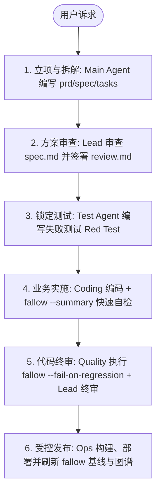

# Herdr Multi-Agent Teamwork (多 Agent 协同工程规范)

本技能通过 Herdr 终端工作区管理工具构建多 Agent 物理隔离与协作体系。
遵循 **OpenSpec 演进标准** 与 **事件驱动免轮询机制 (`herdr agent wait`)**，实现业务规格持久化、职责绝对正交与分形审查网络。

---

## 1. 核心目录组织哲学 (Asset vs Infrastructure)

严格遵循“业务数据资产”与“运行工具基建”物理隔离：

| 目录路径 | 属性 | 定位与核心内容 |
| :--- | :--- | :--- |
| **`changes/`** (根目录) | **第一类业务数据资产 (First-Class Artifacts)** | **业务演进历史与工程规格**：<br>- `changes/KANBAN.md`：全局大盘总看板；<br>- `changes/<id>/prd.md`：业务诉求、痛点与验收标准；<br>- `changes/<id>/spec.md`：技术契约与接口定义；<br>- `changes/<id>/plan.md`：任务切片与时序依赖；<br>- `changes/<id>/tasks.md`：本项执行看板块；<br>- `changes/<id>/review.md`：审查裁决归档。 |
| **`.agents/`** (隐藏目录) | **Agent 运行时支撑基建 (Infrastructure Surface)** | **多 Agent 调度基座**：<br>- `session.json`：Herdr 会话状态快照与跨天恢复；<br>- `skills/herdr-teamwork/roles/`：各 Agent 专属契约库。 |

---

## 2. 变更集核心文档维护准则 (Living Specs & Review Rules)

为防止多轮迭代引起的“文档债务”与“Token 爆炸”，建立统一维护规范：

| 文档类型 | 唯一维护人 (Owner) | 维护策略 | 历史记录处理与格式范式 |
| :--- | :--- | :--- | :--- |
| **`review.md`** | **Lead Reviewer 独占统筹** | **单文件收敛**：严禁各专家私建碎片文件。 | **报纸头条原则 (Newspaper Style) 与披露双清单**：<br>- **顶部法定专区**：<br>  1. 裁决看板 (状态 APPROVED/BLOCKED/CHANGES_REQUESTED、轮次与风险评级 Tier 1/2/3)；<br>  2. 【👥 审查团队构成与专家分流 (Review Team & Experts)】：显式列出本次唤起的专家清单及 pane/职责；若零专家唤起必须注明 Tier 路由依据；<br>  3. 【🛠️ 工具执行与取证清单 (Tool Invocations)】：记录本次实际调用工具名、关键入参、调用目的与返回指标（如 callers、affected processes 等）；<br>  4. 待办摘要与审查意见；<br>- **历史记录处理**：历史轮次向下追加，已解决的历史轮次使用 `<details><summary>` 折叠。 |
| **`prd.md`** | Main Agent (Tech PM) | **就地演进 (In-place)**：需求调整直接在原文修改。 | 文末附 2~3 行简明 `## 变更备忘录 (Changelog)` 记录妥协原因。 |
| **`spec.md`** | Main / Arch Reviewer | **活契约原则 (Living Truth)**：反映当前生效接口。 | 永远呈现最新规范，历史交由 Git 追溯，正文不留冗余弃用字段。 |
| **`tasks.md`** | Main Agent (Tech PM) | **任务状态更新与 Phase 追加**。 | 勾选 `[x]` 与 `[-]`，追加新阶段任务卡片。 |

---

## 3. 角色矩阵与职责正交契约 (Role Contracts)

| 角色 | 契约文件 | 核心职责 | 绝对红线 (Hard Boundaries) |
| :--- | :--- | :--- | :--- |
| **Main Agent** | [`roles/main.md`](roles/main.md) | **Tech PM / 项目总负责人**：需求对齐、任务纵向切片解构、KANBAN 维护、自动调度流水线。 | **严禁亲自编写业务代码、测试用例或执行构建发布**；严禁自我审查；**严禁越权替卡死 Agent 代庖**。 |
| **Coding Agent** | [`roles/coding.md`](roles/coding.md) | **业务代码实现者**：根据 `spec.md` 进行最小行级代码编写，执行 `tsc --noEmit`。 | **严禁修改任何测试文件 (`tests/`)**；严禁过度设计。 |
| **Test Agent** | [`roles/test.md`](roles/test.md) | **质量与测试工程师**：深入 `spec.md` 独立设计测试方案，编写失败用例 (Red) 与全量回归。 | **严禁修改任何业务代码 (`src/`)**；严禁为了变绿而弱化断言。 |
| **Ops Agent** (独立 Tab) | [`roles/ops.md`](roles/ops.md) | **环境守护与发布者**：`npm run build`、后台守护进程、端口探针与受控 Git 发布。 | **严禁修改业务代码与测试**；严禁擅自提前 commit。 |
| **Debug Agent** (按需唤起) | [`roles/debugger.md`](roles/debugger.md) | **法医式排错专家**：逆向推导根因，输出《Fix Spec 修复规格》。 | **只读权限，绝不直接动手改代码**。 |

---

## 4. 专业 Reviewer 分形审查矩阵 (The Reviewer Ensemble)

在独立的 `review` Tab 中，实行 **“一主五专 (1 Lead + 5 Specialists)”** 架构：

```
+-------------------------------------------------------------+
|                     独立 Tab: "review"                      |
+------------------------------+------------------------------+
|                              | 动态专家 Pane (右上)          |
| Lead Reviewer (左侧，全高)   | 按需切出，完成即退            |
| 角色: 主审查统筹与门禁裁决   +------------------------------+
| 模型: gemini-3.8-flash-high  | 动态专家 Pane (右下)          |
| 状态: 常驻                    | 按需切出，完成即退            |
+------------------------------+------------------------------+
```

1. **Lead Reviewer (主审统筹，常驻)** [`roles/reviewer-lead.md`](roles/reviewer-lead.md)：
   - 统筹全局门禁（方案前置审 + 代码终审），平衡 ROI，将最终裁决单一持久化归档至 `changes/<id>/review.md`。
2. **Quality Reviewer (代码健康专家，按需)** [`roles/reviewer-quality.md`](roles/reviewer-quality.md)：
   - **独占消化 `fallow` 与编译器海量原始日志**，过滤噪音，只向 Lead 汇报不超过 15 行的健康指标简报。
3. **Arch Reviewer (架构与设计专家，按需)** [`roles/reviewer-arch.md`](roles/reviewer-arch.md)：
   - 审视深模块设计、状态提升合理性、开闭原则与调用链爆炸半径 (`gitnexus_impact`)。
4. **Perf Reviewer (性能与扩展专家，按需)** [`roles/reviewer-perf.md`](roles/reviewer-perf.md)：
   - 审视 React 重渲染、闭包陷阱、内存泄漏、SQLite 缓存与全表扫描风险。
5. **Security Reviewer (安全合规专家，按需)** [`roles/reviewer-security.md`](roles/reviewer-security.md)：
   - 审视防作弊完备性、XSS/SQL 注入与供应链漏洞。
6. **UX & A11y Reviewer (交互与体验专家，按需)** [`roles/reviewer-ux.md`](roles/reviewer-ux.md)：
   - 审视键盘流热键冲突、焦点捕获管理与组件无障碍属性。

> **生命周期铁律**：专家由 Lead Reviewer 按需分屏切出；专家汇报完毕后，Lead 执行 `herdr pane close` 关闭专家 Pane，保持界面整洁。

### 4.1 风险分级审查通道 (Risk-Tiered Protocol)
根据改动路径、行数与爆炸半径（Blast Radius），Lead Reviewer 严格执行 3 级审查分流，拒绝无意义的 Token 浪费：

| 风险等级 | 判定标准 (触发条件) | 执行方式 | 唤起专家数 |
| :--- | :--- | :--- | :--- |
| **Tier 1：极速通道**<br>(Fast Track) | 改动 < 20 行；纯文档/文案修正；纯样式微调；单文件配置。 | **零专家唤起**。Lead Reviewer 扫视 Diff 秒级核验并签字。 | **0 位** |
| **Tier 2：标准通道**<br>(Standard Track) | 改动 20~150 行；影响 2~4 个文件；局部组件/Hook/单一接口。 | **靶向唤起 1~2 位专家**。Quality 跑 `fallow`，并**定向仅切 1 位专属专家**（改热键切 UX，改查询切 Perf）。 | **1 ~ 2 位** |
| **Tier 3：全面审计**<br>(Full Ensemble) | 涉及防作弊/鉴权；SQLite 核心表/判分引擎；重大重构/全站依赖。 | **多专家并行会审**。并发切出 Quality、Arch、Security 深度审查。 | **3 ~ 5 位** |

### 4.2 审查工具与专家团队透明度硬性约束 (Disclosure Protocol)

1. **🛠️ 工具执行与取证清单 (Tool Invocation Disclosure)**：
   - Reviewer（包含 Lead 及所有垂直专家）在生成 `review.md` 与阶段汇报时，**必须在醒目位置设立【🛠️ 工具执行与取证清单】**；
   - 显式列出本次审查实际调用的工具明细（如 `gitnexus_impact`、`gitnexus_context`、`gitnexus_detect_changes`、`view_file`、`grep` / `rg`、`fallow` 等），包含**关键入参**、**调用目的**与**返回指标**（如 callers 计数、affected processes 列表、risk level 等）；
   - **取证实证铁律**：严禁隐匿工具调用，严禁在未真正调用工具的情况下做口头推测或伪造分析。
2. **👥 专家 Reviewer 调用透明度 (Expert Roster Disclosure)**：
   - Lead Reviewer 必须在 `review.md` 头部设立【👥 审查团队构成与专家分流 (Review Team & Experts)】；
   - 显式汇报本次审查究竟唤起了哪些垂直领域专家（如 Quality / Arch / Security / UX / Perf）及其 pane/职责；
   - 若本次未唤起任何垂直专家（由 Lead Reviewer 独立完成），**必须显式给出 Tier 路由依据与理由**（如“当前为 Tier 1 极速通道 / Tier 2 纯表现层，依据规则由 Lead 独立闭环，不额外唤起垂直专家”），严禁让用户猜测。

---

## 5. 标准多 Agent 协同流水线 (6 步闭环)



### 5.1 流水线流转与人机交接准则 (Pipeline Progression & Handover Rules)

1. **Main Agent 自动调度中枢职责 (Autonomous Pipeline Orchestration)**：
   - Main Agent 作为全局 Tech PM 与调度中枢，核心职责是根据需求与流水线时序，**自动、连贯地依次调度各专属 Agent**（`Reviewer ➔ Test ➔ Coding ➔ Reviewer ➔ Ops`），驱动流水线全自动流转；
   - 只要审查通过且无重大风险（LOW / MEDIUM），**严禁停步等待人类**，必须自动无缝调度下一棒。
2. **通过审查极简通报 (Token 节约准则)**：
   - 若审查通过 (`APPROVED`)，Main Agent **严禁全文搬运或大段复述** Reviewer 的审查细节，仅需输出 1~2 行极简状态通报（包含裁决状态、风险评级）；
   - 提示人类可自行前往 `review.md` 或 `review` Tab 查看工具执行与专家清单详情，避免上下文与 Token 浪费。
3. **低中风险自动流转 (免非必要人工阻断)**：
   - 凡审查通过且不涉及重大风险（非 `HIGH`/`CRITICAL`）或关键路线决策，Main Agent 必须直接自主执行下一步，立即调度 Coding Agent 开展业务编码，严禁停下等待人类决策；
   - **三大法定暂停节点 (Mandatory Human Touchpoints)**：
     1. **初始需求与方案对齐**：需求理解、实施计划与方案设计确认；
     2. **审查驳回或重大分歧**：审查状态为 `BLOCKED` / `CHANGES_REQUESTED` 或涉及高危风险与关键架构路线决策；
     3. **最终浏览器验收与发布授权**：人类在真实环境中体验验收与 Git commit 授权。

### 5.2 故障处置铁律：严禁越权代庖与自愈 SOP (Fault Handling & Self-Healing SOP)

1. **绝对红线：严禁越权代庖与大包大揽 (No Overreach on Agent Stalls)**：
   - 当某个专属 Agent（如 Ops、Coding、Test、Reviewer）发生网络抖动、API 重试、卡死超时或迟迟不响应时，**Main Agent 绝对严禁越权替该 Agent 亲自执行工作**！
   - 严禁 Main Agent 亲自修改业务代码；
   - 严禁 Main Agent 亲自编写或修复测试用例；
   - 严禁 Main Agent 亲自执行 `npm run build`、依赖安装或杀死服务进程重新拉起！
   - 严守契约隔离与角色职责边界，违规代庖将被视为严重破坏架构隔离。
2. **标准故障自愈三步法 (Self-Healing SOP)**：
   - **Step 1：终止与重试 (Abort & Retry)**：在 Herdr 中发送终止按键（`herdr agent send-keys <TARGET> ctrl+c`）复位状态，并使用 `herdr agent get <TARGET>` 确认就绪后重新下发指令；
   - **Step 2：重启 Agent (Reboot)**：若重试仍无响应，在对应 Pane 中重启该 Agent（退出并重新执行 `herdr agent start`），再行派发；
   - **Step 3：升级汇报 (Escalate to Human)**：若上述自愈步骤均失败，向人类透明汇报卡点、报错原因与现场日志，寻求人类协助。

---

## 6. Herdr 免轮询调度与等待技巧 (`herdr agent wait`)

**严禁使用定时器轮询 (`schedule`) 频繁切屏！** 采用事件驱动等待：

```bash
# 1. 推荐：原子派发与阻塞等待（官方推荐，5 秒活动门禁防竞态）：
herdr agent prompt coding "请阅读 changes/002/spec.md 和 changes/002/tasks.md，严格依据契约实施 Phase 1 业务代码" --wait --timeout 120000

# 2. 唤醒后读取结构化输出（使用 --source recent-unwrapped 避免终端软换行折断 Markdown/表格）：
herdr agent read coding --source recent-unwrapped --lines 50

# 3. （备用）被动阻塞等待后台/独立 Agent（不带 --until，避免 idle 与 seen 状态错位超时）：
herdr agent wait ops --timeout 90000
```

### 6.1 Prompt 契约文件显式指引铁律 (Explicit Contract Path in Prompt)

- **核心机制**：各执行 Agent（如 Coding、Test）只要在 Prompt 中看到明确的文件路径，就会主动查阅并通读契约。此机制彻底保障 `changes/` 目录活文档成为贯穿开发与测试全链路的唯一真理源，防止文档沦为摆设。
- **Main Agent 派发红线**：向执行角色派发任务时，**严禁仅使用模糊的一两句自然语言指令**，必须在 Prompt 中显式指出目标契约文件路径与当前切片，并推荐启用原子 `--wait`：
  ```bash
  # 派发至 Coding Agent（原子派发与等待）：
  herdr agent prompt coding "请阅读 changes/<id>/spec.md 与 changes/<id>/tasks.md，严格依据契约实施 Phase X 业务代码" --wait --timeout 120000

  # 派发至 Test Agent：
  herdr agent prompt test "请阅读 changes/<id>/spec.md，依据验收标准与数据模型设计编写失败测试 (Red Test)" --wait --timeout 120000

  # 派发至 Reviewer：
  herdr agent prompt reviewer "请依据 changes/<id>/spec.md 执行 Phase 1 方案前置审查，并更新 changes/<id>/review.md" --wait --timeout 120000
  ```
- **执行角色首动规约**：Coding Agent 与 Test Agent 收到任务后，**必须将通读指引的契约文件作为首要执行步骤**，严禁在未阅读契约前盲目编写代码或测试。

---

## 7. 会话持久化与跨天秒级复活 (Session Persistence)

会话状态保存在 `.agents/session.json`：
- **保存快照（动态注入当前工作区与项目名）**：
  ```bash
  herdr agent list | jq --arg ws "${HERDR_WORKSPACE_ID:-w1}" --arg proj "$(basename "$PWD")" '{updated_at: (now | todate), workspace_id: $ws, project: $proj, agents: [.result.agents[] | {key: (.name // "main"), value: {name: (.name // "main"), pane_id, tab_id, conversation_id: .agent_session.value, model: (.terminal_title | capture("--model (?<m>[^ ]+)") | .m // "gemini-3.8-flash-high")}}] | from_entries}' > .agents/session.json
  ```
- **复活 Agent（继承 100% 记忆）**：
  ```bash
  CODING_ID=$(jq -r '.agents.coding.conversation_id' .agents/session.json)
  TARGET_PANE=$(jq -r '.agents.coding.pane_id // "${HERDR_WORKSPACE_ID:-w1}:p2"' .agents/session.json)
  herdr agent start coding --kind agy --pane "$TARGET_PANE" -- --conversation "$CODING_ID" --model gemini-3.8-flash-medium
  ```

---

## 8. 智能代码定位与图谱导航规范 (Code Intelligence & Navigation)

为提高定位效率、节省上下文 Token 并避免信息迷航，**强烈建议优先使用 GitNexus 知识图谱进行定位**，避免在毫无线索时盲目对大文件进行全量通读。遵循**“图谱定位先行、精准切片读取”**的最佳实践：

### 8.1 武器库定位矩阵 (何时用什么？)

| 场景与意图 | 首选武器 | 说明与使用范式 | 举例命令 |
| :--- | :--- | :--- | :--- |
| **已知函数名/符号**<br>(查确切行号与上下游) | **`gitnexus context`**<br>(狙击镜头) | **确定性极高，零查空风险**。<br>秒级锁定定义文件与起始行号，并返回 360 度调用拓扑（谁调它、它调谁）。 | `gitnexus context --repo <repo> handleAction`<br>`gitnexus context --repo <repo> parseInput` |
| **探索未知链路/业务概念**<br>(看数据流与拓扑) | **`gitnexus query`**<br>(卫星航拍) | **全局流程拓扑 (Execution Flow)**。<br>用于方案设计、排查跨层链路 Bug（前端 ➔ API ➔ DB），或不知道函数名时顺藤摸瓜。**提示：必须使用简短英文概念词**。 | `gitnexus query --repo <repo> "user auth"`<br>`gitnexus query --repo <repo> "data sync"` |
| **评估改动爆炸半径**<br>(改动前评估风险) | **`gitnexus impact`**<br>(雷达预警) | **向上追溯直接调用方与受影响流程**。<br>修改核心模块或公共接口前必跑，避免意外击穿下游。 | `gitnexus impact --repo <repo> -d upstream handleAction` |
| **验证改动范围与影响面**<br>(改动后/终审门禁) | **`gitnexus detect-changes`**<br>(照妖镜门禁) | **将 Git Diff 映射到具体符号与业务流**。<br>验证当前代码改动是否超出预期边界，确认 Risk Level 与 Affected Processes。 | `gitnexus detect-changes --repo <repo>`<br>`gitnexus detect-changes --repo <repo> --scope staged` |
| **查界面文本或精准报错**<br>(终极正则探针) | **`rg -n` (ripgrep)**<br>(极速探针) | **毫秒级定位 UI 特征字或配置项**。<br>当已知按钮文案（如“确认提交”）、报错字面量或环境变量时，0.005 秒锁定行号。 | `rg -n "确认提交" src/`<br>`rg -n "export function handleAction" src/` |

### 8.2 标准定位流转闭环

```mermaid
flowchart TD
    Need[需要查阅/修改代码] --> SymbolKnown{是否已知函数名/符号名？}

    SymbolKnown -->|是: 强烈优先| Ctx[1. gitnexus context <symbol><br/>获取精确 startLine/endLine 与上下游]
    SymbolKnown -->|否: 仅知业务动作| Qry[2. gitnexus query <english_concept><br/>获取业务执行流拓扑 Execution Flow]

    Ctx & Qry -->|若选词偏差查空| Probe[3. rg -n <特征字> 毫秒级探针兜底]

    Ctx & Qry & Probe --> Slice[外科手术式切片精准读取<br/>指定 StartLine 与 EndLine (50~100行)]
```

### 8.3 `detect-changes` 三重质量防线 (何时用？给谁用？)

1. **Coding Agent 自检**：编写业务代码完成后、向 Main 汇报前，跑 `gitnexus detect-changes` 自我核验范围；
2. **Reviewer 终审门禁**：执行 Phase 2 代码终审时，主审/架构专家跑 `gitnexus detect-changes` 检查 `Affected processes` 是否越权；
3. **Ops Agent 提交防线**：在受控发布执行 `git commit` 前，跑 `gitnexus detect-changes --scope staged` 拦截异常暂存产物。并在发布完成后自动执行 `gitnexus analyze` 刷新图谱。


