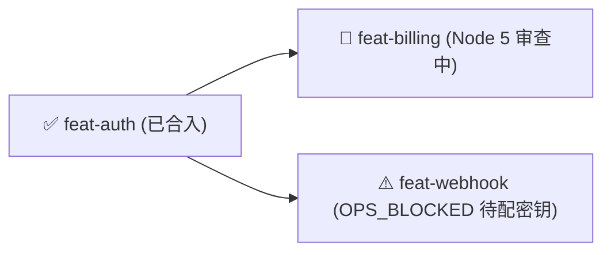

# Playbook: 人类回场全局简报与决策对齐 (`ketchup-briefing`)

> **设计溯源**：融合自 Lauren Tan (`pstack`) 的 `ketchup` 技能与 Matt Pocock 的 `pr`（单向门 vs 双向门风险定级）规范。

---

## 1. 适用场景与触发条件 (When to Use)

在多 Agent 自动化流水线中，后台十几个窗格往往会连续自主运转数十分钟甚至数小时。在以下任一场景下，由 Window 1 的 **`planner`** 自动触发本剧本：
1. **人类回场询问进展**：当后台流水线连续流转了多个节点（完成了若干特性、发生了重构打回或遇到了环境/架构卡点），人类回到 Window 1 询问“现在什么情况？”、“进展如何？”或“有什么需要我看的？”。
2. **里程碑/复杂特性收尾汇报（`DONE` 验收简报）**：当一个非平凡的 Feature（或一组并行 Worktree 任务）流转到 `DONE`，向人类发起最终实机验收与合入确认时。

---

## 2. 角色分工链路 (Role Handoff Chain)

```
[Human] 回到 Window 1 询问进展 / 或 [dispatcher] 通知特性到达 DONE 或 ESCALATED
        │
        ▼
[planner] 读取 KANBAN.md + changes/pipeline.jsonl + 相关 changes/*/result.md
        │ (严格在 planner 只读白名单内完成，绝不翻阅海量源码)
        ▼
[planner] 按 Ketchup 四段式结构向人类输出高信噪比简报与自包含决策项
```

---

## 3. `planner` 输出回场简报的 4 段式标准结构

> **核心原则**：人类刚回到电脑前时，**严禁让人类自己去翻阅几十条 `pipeline.jsonl` 日志或打开多个 `result.md` 才能拼凑出全貌！** 你的回复必须是 100% 自包含（Self-Contained）的——人类只看你这一条回复，就能完全看懂现状并直接拍板所有卡点。

### 第一段：一句话全局态势 + 最小可视化进度图（Visual Snapshot）
先用一句话概括“自你上次发话以来，系统完成了什么、当前停在哪个位置”，紧接着给出一个紧凑的 Mermaid 状态图或看板摘要表：



### 第二段：已完成变更的实证摘要与「单/双向门」定级（What Landed & Merge Danger）
对期间已完成（`DONE`）等待人类验收或合入的特性，用极简人话（拒绝照抄函数名和文件路径流水账）说明：
1. **改了什么 & 实证证据**：从用户/业务视角说明行为变化，并列出已通过的客观证据（如：`单测 24/24 通过`、`fallow 零死代码`、`E2E 实机截图已验证`）。
2. **合入风险定级（One-Way vs Two-Way Door）**：
   * 🟢 **双向门（Two-Way Door — 可随时无损回滚）**：纯新增模块、特性开关保护或内部实现替换，随时 `git revert` 无副作用。
   * 🔴 **单向门（One-Way Door — 不可逆或高代价回滚）**：涉及数据库 Schema 破坏性迁移、持久化数据格式变更、公开 API 协议不兼容修改或外部配置变更。必须显式标出**爆炸半径（Blast Radius）**与回滚预案！

### 第三段：人类实机验收清单（Human Test Checklist）
对已就绪等待人类亲自体验的功能，按 `AGENTS.md` 规范列出清晰的浏览器/终端实机操作步骤（在哪打开、点什么、预期看到什么）。

### 第四段：待人类拍板的自包含选择题（Decisions Waiting on You）
如果当前有阻塞项（如 `ESCALATED`、`OPS_BLOCKED`、架构分支选择或 `reflector` 提炼的 `🔬 SPIKE_CANDIDATE`），必须将每一个待决问题包装成**无需翻上下文即可直接回答的选择题**：
* **背景与卡点原因**（2~3 句话讲清楚为什么卡住）；
* **候选方案对比**（如 `方案 A [推荐]：...（优缺点）` vs `方案 B：...（优缺点）`）；
* 人类只需回复“1 选 A，2 我已经运行完向导脚本”即可瞬间恢复整条流水线。
