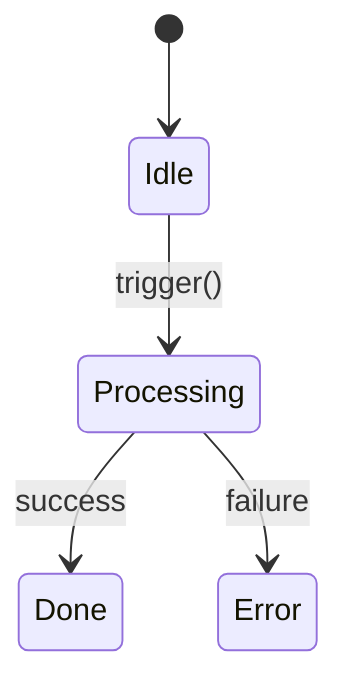

# Technical Spec: <特性名称> (`changes/<id>/spec.md`)

> **维护铁律**：遵循**活契约原则 (`Living Truth`)**，由窗口 1 **`Planner`** 维护（可经 `reviewer-arch` / `reviewer-security` Stage 1 预审或圆桌辩论修订）。反映当前生效的最新接口签名与架构边界，原地更新不留废弃字段，历史交由 Git 追溯。

---

## 1. 架构边界与领域内聚 (Architecture & Domain Boundaries)
- **所属有界上下文 / 领域目录**：`src/<domain>/`（遵循领域垂直内聚，通过单一门面入口对外暴露）
- **上游调用方与受波及流程 (`gitnexus impact`)**：<列出受影响的上游模块与存量业务链路>
- **不可破坏的既有不变量 (`Invariants & Non-Regression`)**：
  - <明确本次修改绝不能破坏的存量行为或数据一致性约束>

---

## 2. 核心接口与数据结构契约 (`Design It Twice` 择优方案)
> *(注：核心新增/重构接口已经过至少 2 套候选方案对比隐藏复杂度与调用局部性后择优落盘)*

```typescript
// 在此定义精确的类型签名、函数接口、配置结构或 API Schema（零模糊伪代码）
```

---

## 3. 状态流转与异常防御矩阵 (Statechart & Edge Cases)
> *(若触及复杂状态机、并发竞态、异步重试或解析器，必须按 [`playbooks/formal-statechart.md`](../../.agents/skills/herdr-teamwork/playbooks/formal-statechart.md) 绘制含「禁止状态」的 Mermaid `stateDiagram-v2`)*



---

## 4. 编号化技术验收条件 (`AC-*` — 供 `tdd` 编写断言与 `reviewer-lead` 对账)

| 验收编号 | 触发条件与输入 (`Given / When`) | 确定性预期输出与状态变化 (`Then`) | 异常/边界防御要求 |
| :--- | :--- | :--- | :--- |
| **`AC-1`** | <输入条件 1> | <精确返回值/状态变更/副作用> | <空值/越界/重入时的精确错误码或回退行为> |
| **`AC-2`** | <输入条件 2> | <精确返回值/状态变更/副作用> | <超时/并发冲突时的处理方式> |
